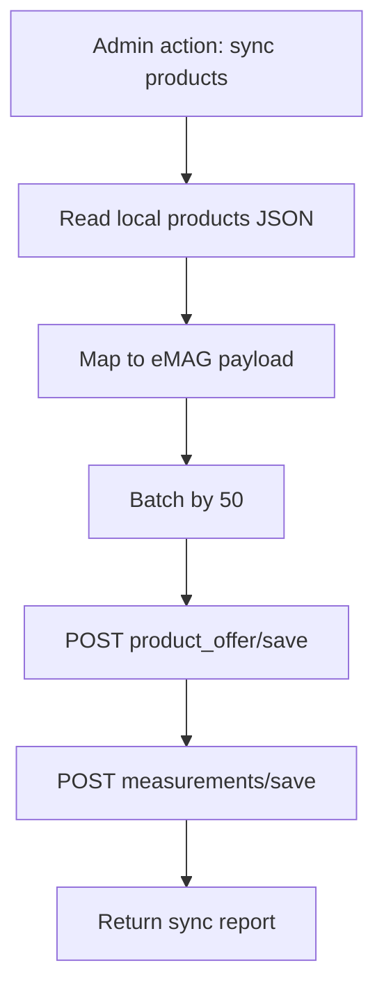
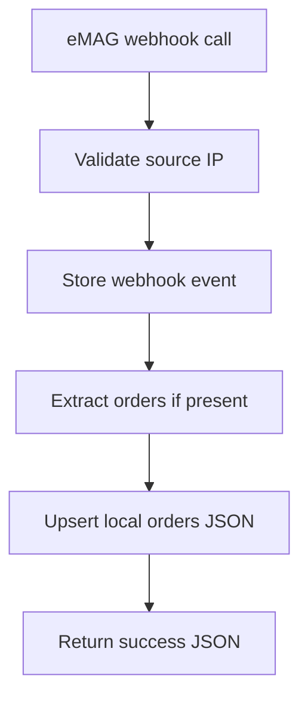

# eMAG Marketplace Integration

This project integrates with eMAG Marketplace API version 4.4.8 using Next.js App Router route handlers.

## Environment Variables

Set the following variables in your environment file.

- EMAG_USERNAME: eMAG API username
- EMAG_PASSWORD: eMAG API password
- EMAG_BASE_URL: marketplace base URL, example https://marketplace-api.emag.bg/api-3
- EMAG_RELAY_SHARED_SECRET: optional shared secret sent as x-relay-secret header when using a private relay
- EMAG_ADMIN_TOKEN: token required by the eMAG admin API routes (recommended)
- EMAG_WEBHOOK_ALLOWED_IPS: comma-separated list of source IPs allowed to call webhook endpoint
- EMAG_CATEGORY_MAP_JSON: JSON map from local category key to eMAG category id
- EMAG_CHARACTERISTICS_MAP_JSON: optional JSON map for auto-filled eMAG category characteristics by category and characteristic id
- EMAG_FAMILY_MAP_JSON: optional JSON map for explicit eMAG family assignment per product id/model
- EMAG_ENABLE_AUTO_FAMILY: set to 1 to infer families from model suffixes (EP/WP/WPB/NR)
- EMAG_FAMILY_TYPE_ID: family type id used when EMAG_ENABLE_AUTO_FAMILY=1 (default 1)
- EMAG_COLOR_CHARACTERISTIC_ID: characteristic id used for auto color value (default 5401)
- EMAG_CATEGORY_ID_DEFAULT: fallback category id when category key is missing
- EMAG_VAT_ID: default eMAG VAT id
- EMAG_WAREHOUSE_ID: default eMAG warehouse id
- EMAG_WARRANTY_MONTHS: default warranty months sent in offer payload (optional)
- EMAG_MIN_SALE_PRICE_FACTOR: multiplier for min_sale_price (default 0.9)
- EMAG_MAX_SALE_PRICE_FACTOR: multiplier for max_sale_price (default 1.1)
- EMAG_RECOMMENDED_PRICE_FACTOR: optional multiplier for recommended_price (>1.0)
- EMAG_HANDLING_TIME_DAYS: default handling time value
- EMAG_BRAND: fallback brand name
- EMAG_DEFAULT_EAN: fallback EAN when unknown
- EMAG_SOURCE_LANGUAGE: source language for product content, default bg_BG
- EMAG_DEFAULT_WEIGHT_GRAMS: fallback measurement weight
- EMAG_DEFAULT_WIDTH_MM: fallback measurement width
- EMAG_DEFAULT_HEIGHT_MM: fallback measurement height
- EMAG_DEFAULT_LENGTH_MM: fallback measurement length
- EMAG_PUBLIC_SITE_URL: base URL used to convert relative product image paths to absolute URLs
- EMAG_OVERRIDES_PATH: optional path for product-level eMAG overrides JSON (advanced mode only)
- EMAG_PRODUCT_ID_MAP_JSON: optional JSON map to pin eMAG numeric IDs by local `id` or `model`

## Implemented Routes

- POST /api/emag/sync-products
- GET /api/emag/sync-products
- GET /api/emag/vat-options
- GET /api/emag/offer-vat-samples
- POST /api/emag/update-stock
- POST /api/emag/update-price
- POST /api/emag/orders
- GET /api/emag/orders
- POST /api/emag/webhook
- GET /api/emag/webhook
- GET /api/emag/sync-runs
- GET /api/admin/order-events

All protected routes accept token by one of these methods:

- x-admin-token header
- Authorization: Bearer token
- query string token parameter

## Route Details

### POST /api/emag/sync-products

- Reads all products from data/products/products.json
- Loads localized content from data/products/content.bg.json with field-level fallback to data/products/content.en.json
- Loads optional product overrides from data/products/emag.overrides.json (or EMAG_OVERRIDES_PATH)
- Maps products to eMAG offer payload
- Uses description priority: overrides.description -> localized BG description -> generated fallback text
- Sends batches to /product_offer/save
- Sends measurements in matching batches to /measurements/save
- Returns sync report with failed batches
- On failures, returns `debugFailurePreview` (first failed payload samples with `vat_id`, `category_id`, and image diagnostics)
- Persists every sync run to data/emag/sync-runs.json for history and auditing
- Sends additional offer constraints automatically (`url`, `min_sale_price`, `max_sale_price`, optional `recommended_price`) to reduce manual work in eMAG offer wizard

### GET /api/emag/sync-products

- Protected debug preview endpoint
- Requires one of `id` or `model` query parameters
- Returns mapped outbound payload preview (`offerPayload` + `measurementPayload`) without sending to eMAG
- Includes diagnostics for `vat_id`, `category_id`, and image presence

### GET /api/emag/vat-options

- Protected helper endpoint for VAT diagnostics
- Calls eMAG `/vat/read` with server credentials
- Tries both request body shapes (`{}` and `{ "data": {} }`) for compatibility
- Returns normalized VAT options list for admin UI (`id`, `name`, `value`) so `EMAG_VAT_ID` can be selected correctly

### GET /api/emag/offer-vat-samples

- Protected helper endpoint to inspect existing offer VAT usage
- Calls eMAG `/product_offer/read` and returns sample offers with `vatId`, `categoryId`, and `partNumber`
- Includes frequency map of returned VAT IDs (`vatIdFrequency`) to quickly identify the active VAT id used on live offers

### POST /api/emag/update-stock

- Reads all products from data/products/products.json
- Maps product quantity to eMAG stock payload
- Updates stock with PATCH /offer_stock/{resourceId}; eMAG does not provide a bulk stock-save endpoint
- Sends `{ "value": <quantity> }`, where `resourceId` is the mapped seller product ID

### POST /api/emag/update-price

- Reads all products from data/products/products.json
- Maps finalPriceEur to sale_price
- Updates prices in batches via /product_offer/save

### POST /api/emag/orders

- Reads latest orders from /order/read
- Accepts optional filters in request body
- Saves orders locally in data/emag/orders.json
- Acknowledges each newly inserted order via /order/acknowledge/{orderId}

### GET /api/emag/orders

- Reads saved orders from local storage
- Supports limit query parameter

### POST /api/emag/webhook

- Validates source IP against allowed list
- Stores incoming event in data/emag/webhook-events.json
- Attempts to extract and upsert orders from webhook payload
- Acknowledges newly inserted orders via /order/acknowledge/{orderId}

### GET /api/emag/webhook

- Validates source IP against allowed list
- Accepts `order_id` (or `orderId`) query parameter
- Reads the order by ID from /order/read
- Saves the order locally and acknowledges it via /order/acknowledge/{orderId}

### GET /api/emag/sync-runs

- Requires the same admin token logic as other protected eMAG admin routes
- Returns persisted product sync run history
- Reads from `data/emag/sync-runs.json`

### GET /api/admin/order-events

- Requires the same admin token logic as other protected eMAG admin routes
- Returns a unified timeline that labels each event source (`stripe` or `emag`)
- Stripe events come from `stripe_webhook_events` (or synthetic file-based order events when DB is not configured)
- eMAG events come from `data/emag/webhook-events.json`

## Request Body Conventions

The implementation follows the eMAG OpenAPI body conventions:

- save/write endpoints are sent with data array wrapper
- read/count endpoints are sent with top-level filters
- Product `ean` is sent as an array, including single-barcode products

## Recommended Data Ownership

To avoid duplicated maintenance:

- Keep prices, quantity, and EAN in the main Prices sheet.
- Keep brand, dimensions, and fallback eMAG metadata as environment defaults.

Main import script now reads EAN from the Prices sheet into data/products/products.json.

## Product Overrides Exchange (Optional)

If you need per-product exceptions for brand/description/measurements later, use an override source file:

- data/products/emag.overrides.json

Supported override fields per product:

- brand
- ean
- stock
- description
- weight
- width
- height
- length

Example `EMAG_CHARACTERISTICS_MAP_JSON` value:

```json
{
  "room-thermostat": {
    "5704": "Термостат",
    "8434": "Вътрешна употреба",
    "7597": "BEOK",
    "9645": {
      "electric": "Електрическо подово отопление",
      "water": "Водно подово отопление",
      "gas-boiler": "Газов котел"
    }
  }
}
```

Example `EMAG_FAMILY_MAP_JSON` value:

```json
{
  "tgm50-wifi-ep": {
    "name": "TGM50-WIFI",
    "family_type_id": 1,
    "color": "Бял"
  },
  "tgm50-wifi-wp": {
    "name": "TGM50-WIFI",
    "family_type_id": 1,
    "color": "Бял"
  },
  "tgm50b-wifi-ep": {
    "name": "TGM50B-WIFI",
    "family_type_id": 1,
    "color": "Черен"
  },
  "tgm50b-wifi-wp": {
    "name": "TGM50B-WIFI",
    "family_type_id": 1,
    "color": "Черен"
  }
}
```

When syncing products to eMAG, override fields are applied on top of base product data. If `description` is set in overrides, it always takes precedence over the localized content description.

The import script can also populate overrides directly from an Excel sheet:

- npm run prices:import -- --file "<your-file.xlsx>" --use-overrides-sheet --overrides-sheet "emag_overrides"

Expected columns on emag_overrides sheet:

- id or model (required)
- brand
- ean
- stock
- description
- weight
- width
- height
- length

## Rate Limit Strategy

The eMAG client includes an in-memory throttle:

- orders resources: up to 12 requests per second
- all other resources: up to 3 requests per second

Note: throttle state is process-local and may reset on deployment or server restart.

## API Flow Diagrams



## eMAG product IDs

The local catalog uses string SKUs such as `tgm50-wifi-ep`, while eMAG requires
the seller's internal product ID to be a positive integer. The mapper derives a
stable integer ID from each local SKU and sends the original SKU as `part_number`.
Do not change a product's local `id` after it has been published to eMAG.

If you need to pin specific numeric IDs (for example to match previously created
offers), configure `EMAG_PRODUCT_ID_MAP_JSON`:

```json
{
  "tgm50-wifi-ep": 10542,
  "TGM50-WIFI-EP": 10542
}
```



## Troubleshooting

- 401 unauthorized
  - Check EMAG_ADMIN_TOKEN
  - Include x-admin-token or bearer token in request

- 403 forbidden_source_ip on webhook
  - Check EMAG_WEBHOOK_ALLOWED_IPS
  - Confirm forwarding headers are set by your proxy

## Railway + Contabo relay (fixed outgoing IP)

Use this when eMAG must allowlist a single fixed outgoing IP while the app is hosted on Railway.

Detailed step-by-step runbook (Windows PowerShell driven):

- [eMAG relay setup (Contabo + Railway) via PowerShell](./emag-relay-contabo-railway-powershell.md)

1. Create DNS record:
   - A record `emag-relay.beoksmart.com` -> your Contabo IPv4
2. On Contabo VPS install and enable Nginx + TLS cert for `emag-relay.beoksmart.com`.
3. Configure Nginx to proxy all requests to `https://marketplace-api.emag.bg/api-3/`.
4. Add shared secret check in Nginx (recommended) and set the same secret in Railway:
   - `EMAG_RELAY_SHARED_SECRET=<long-random-secret>`
5. In Railway set:
   - `EMAG_BASE_URL=https://emag-relay.beoksmart.com`
6. Keep normal API auth vars:
   - `EMAG_USERNAME`, `EMAG_PASSWORD`
7. Redeploy and run eMAG admin actions to verify connectivity.

- eMAG rate limit exceeded
  - Reduce call frequency
  - Retry with exponential backoff

- Missing or rejected category mapping
  - Set EMAG_CATEGORY_MAP_JSON and EMAG_CATEGORY_ID_DEFAULT
  - Verify category ids with /category/read

- Product sync succeeds but offer visibility is missing
  - Review eMAG validation rules and response messages
  - Confirm mandatory category attributes in eMAG catalog

## Admin UI

A lightweight operator page is available at:

- /admin/emag

Use this page to trigger sync, stock update, price update, and order retrieval operations and inspect raw API responses.

## Product URL crawler readiness (for eMAG URL import)

The product detail page now exposes structured data fields that eMAG crawlers expect:

- Product + SKU + model + brand
- GTIN (`gtin13` when EAN is 13 digits)
- Offer (`price`, `priceCurrency`, `availability`, product URL)
- `inventoryLevel` based on local stock quantity (`priceQty`)

Operational notes:

- Keep `NEXT_PUBLIC_SITE_URL` set to the live domain so schema URLs are absolute and correct.
- Keep product pages publicly reachable without auth.
- Keep `robots.txt` and `sitemap.xml` enabled in production.
